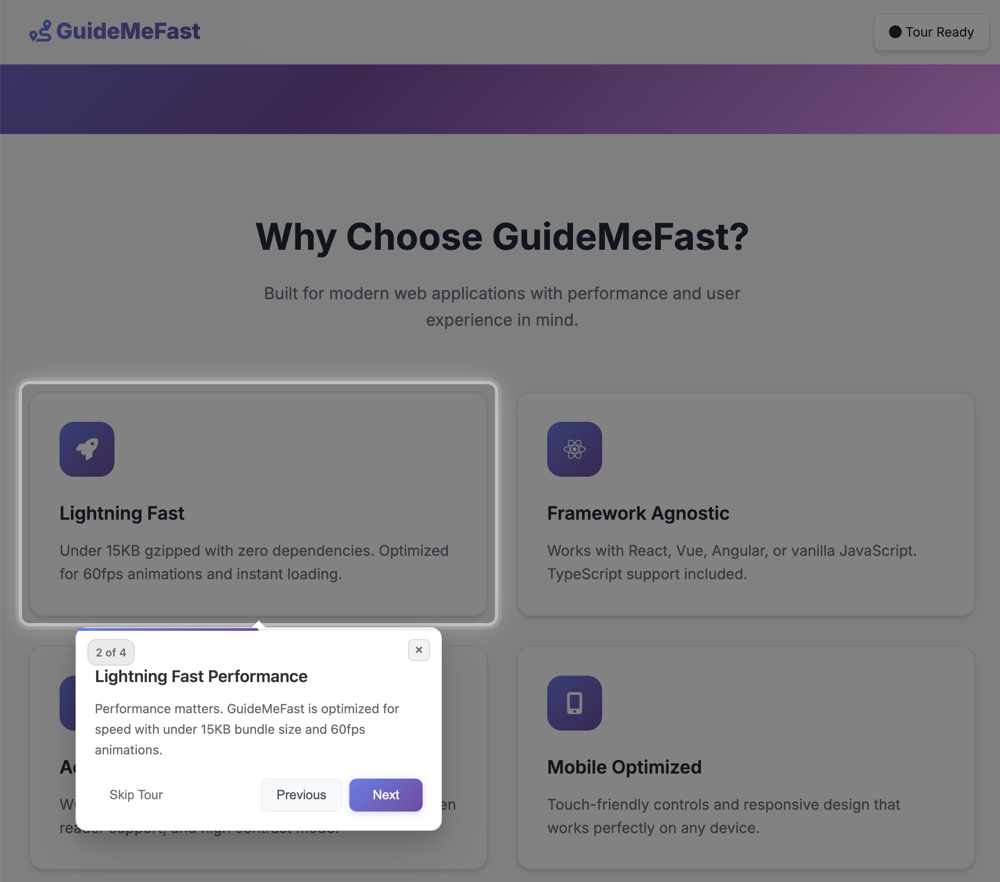

# 🚀 GuideMeFast

Beautiful, lightweight library for creating interactive guided tours in web applications. A modern, feature-rich alternative to Intro.js with full React and Material-UI support.

[](https://badge.fury.io/js/guidemefast)
[](https://opensource.org/licenses/MIT)
[](http://www.typescriptlang.org/)
[](https://github.com/eckopage/guidemefast/actions)

<p align="center">
    
</p>

## ✨ Features

- 🎨 **Beautiful UI** - Modern, clean design with smooth animations
- ⚛️ **React Support** - First-class React hooks and components
- 🎭 **Material-UI Integration** - Native Material-UI components
- 🌟 **Vanilla JS** - Works without any framework
- 📱 **Responsive** - Mobile-friendly and touch-optimized
- 🎯 **TypeScript** - Full type safety and IntelliSense
- 🎪 **Customizable** - Extensive theming and styling options
- ♿ **Accessible** - WCAG 2.1 AA compliant with keyboard navigation
- 📦 **Lightweight** - Under 15KB gzipped
- 🚀 **Performance** - Optimized for smooth 60fps animations

## 🆕 New Enhanced Features

### 🌍 Multi-language Support (i18n)
- **5 Built-in Languages**: English, Polish, Spanish, French, German
- **Easy Custom Translations**: Add your own languages effortlessly
- **Template System**: Dynamic text with placeholders like `"{current} of {total}"`
- **RTL Support**: Full right-to-left language compatibility

### 📝 Complete Text Customization
- **Global Overrides**: Change any button/text globally via `customTexts`
- **Step-level Overrides**: Different text per step via `step.customTexts`
- **Dynamic Content**: Functions that receive translations for context-aware text
- **Accessibility Texts**: Custom ARIA labels and screen reader content

### ⌨️ Advanced Keyboard Support
- **Full Navigation**: Arrow keys, Space, Enter, Escape, Backspace
- **Custom Shortcuts**: Define your own key combinations
- **Accessibility**: Focus management and screen reader integration
- **Visual Indicators**: Keyboard shortcut hints and help system

### 🤖 AI Integration
- **Content Personalization**: AI adapts step content based on user profile
- **Flow Optimization**: AI reorders steps based on user behavior patterns
- **Auto-generation**: AI creates tour steps by analyzing page elements
- **Real-time Learning**: Users can personalize content during the tour

## 🚀 Quick Start

### Installation

```bash
npm install guidemefast
# or
yarn add guidemefast
# or
pnpm add guidemefast
```

### React Usage with Enhanced Features

```jsx
import React from 'react';
import { useEnhancedGuideMeFast } from 'guidemefast';
import 'guidemefast/dist/styles.css';

function App() {
  const tourConfig = {
    // Multi-language support
    locale: 'en', // or 'pl', 'es', 'fr', 'de'
    
    // Keyboard shortcuts
    keyboard: {
      enabled: true,
      shortcuts: {
        next: ['arrowright', 'space'],
        previous: ['arrowleft'],
        skip: ['s'],
        close: ['escape']
      }
    },
    
    // AI personalization (optional)
    ai: {
      enabled: true,
      features: {
        personalizeContent: true
      },
      onAIRequest: async (prompt, context) => {
        // Your AI integration (OpenAI, Anthropic, etc.)
        const response = await fetch('/api/ai/personalize', {
          method: 'POST',
          body: JSON.stringify({ prompt, context })
        });
        return await response.text();
      }
    },
    
    // Global text customization
    customTexts: {
      next: 'Continue',
      skip: 'Skip Tour',
      finish: 'Complete'
    },
    
    steps: [
      {
        target: '#welcome-button',
        title: 'Welcome! 👋',
        content: 'This is your main dashboard. Click here to get started.',
        placement: 'bottom',
        
        // Step-level text override
        customTexts: {
          next: 'Show me more'
        },
        
        // AI context
        aiContext: {
          userRole: 'developer',
          difficulty: 'beginner',
          personalizable: true
        }
      },
      {
        target: '#profile-menu',
        // Dynamic content with translations
        title: (translations) => `${translations.next} Step`,
        content: 'Manage your profile and preferences from here.',
        placement: 'left'
      }
    ],
    
    onComplete: () => {
      console.log('Tour completed!');
    }
  };

  const { 
    startTour, 
    personalizeCurrentStep,
    setUserContext 
  } = useEnhancedGuideMeFast(tourConfig);

  // Set user context for AI personalization
  React.useEffect(() => {
    setUserContext({
      role: 'developer',
      experience: 'intermediate',
      preferences: { theme: 'dark' }
    });
  }, []);

  return (
    <div>
      <button id="welcome-button" onClick={startTour}>
        Start Tour
      </button>
      <div id="profile-menu">Profile</div>
    </div>
  );
}
```

### Vanilla JavaScript with Enhanced Features

```html
<!DOCTYPE html>
<html>
<head>
  <link rel="stylesheet" href="https://unpkg.com/guidemefast@latest/dist/styles.css">
</head>
<body>
  <button id="start-tour">Start Tour</button>
  <div id="feature-1">Feature 1</div>
  <div id="feature-2">Feature 2</div>

  <script src="https://unpkg.com/guidemefast@latest/dist/vanilla.js"></script>
  <script>
    const tour = new GuideMeFast({
      locale: 'en', // Multi-language support
      
      keyboard: {
        enabled: true,
        shortcuts: {
          next: ['arrowright', 'space'],
          previous: ['arrowleft'],
          skip: ['s'],
          close: ['escape']
        }
      },
      
      customTexts: {
        next: 'Next Step',
        previous: 'Go Back',
        skip: 'Skip Tutorial',
        finish: 'Done'
      },
      
      steps: [
        {
          target: '#feature-1',
          title: 'Amazing Feature',
          content: 'This feature will help you be more productive!',
          placement: 'right',
          customTexts: {
            next: 'Show next feature'
          }
        },
        {
          target: '#feature-2',
          title: 'Another Feature',
          content: 'And this one is even cooler!',
          placement: 'top'
        }
      ]
    });

    document.getElementById('start-tour').addEventListener('click', () => {
      tour.start();
    });
  </script>
</body>
</html>
```

## 📖 Enhanced API Reference

### TourConfig Interface

```typescript
interface TourConfig {
  steps: TourStep[];
  onComplete?: () => void;
  onSkip?: () => void;
  
  // Multi-language support
  locale?: string;                      // Default: 'en'
  translations?: TourTranslations;      // Custom translations
  customTexts?: {                       // Global text overrides
    next?: string;
    previous?: string;
    skip?: string;
    finish?: string;
    close?: string;
    loading?: string;
  };
  
  // AI Configuration
  ai?: {
    enabled: boolean;
    apiKey?: string;
    provider?: 'openai' | 'anthropic' | 'custom';
    features?: {
      personalizeContent?: boolean;
      optimizeFlow?: boolean;
      generateSteps?: boolean;
    };
    customEndpoint?: string;
    onAIRequest?: (prompt: string, context: any) => Promise<string>;
  };
  
  // Keyboard Support
  keyboard?: {
    enabled: boolean;                    // Default: true
    shortcuts?: {
      next: string[];                    // Default: ['arrowright', 'space', 'enter']
      previous: string[];                // Default: ['arrowleft', 'backspace']
      skip: string[];                    // Default: ['ctrl+s', 'alt+s']
      close: string[];                   // Default: ['escape', 'ctrl+c']
      finish: string[];                  // Default: ['ctrl+enter', 'alt+enter']
    };
    preventDefaults?: boolean;
  };
  
  // Visual settings
  theme?: 'light' | 'dark' | 'material';
  showProgress?: boolean;
  showStepNumbers?: boolean;
  backdropOpacity?: number;
  highlightPadding?: number;
  scrollBehavior?: 'smooth' | 'auto';
  zIndex?: number;
  closeOnEscape?: boolean;
  closeOnClickOutside?: boolean;
  customStyles?: {
    tooltip?: React.CSSProperties;
    backdrop?: React.CSSProperties;
    highlight?: React.CSSProperties;
  };
}
```

### TourStep Interface

```typescript
interface TourStep {
  target: string;
  title: string | ((translations: TourTranslations[string]) => string);
  content: string | ((translations: TourTranslations[string]) => string);
  placement?: 'top' | 'bottom' | 'left' | 'right';
  
  // Step-level text customization
  customTexts?: {
    next?: string;
    previous?: string;
    skip?: string;
    finish?: string;
  };
  
  // AI context
  aiContext?: {
    userRole?: string;
    difficulty?: 'beginner' | 'intermediate' | 'advanced';
    importance?: 'low' | 'medium' | 'high';
    personalizable?: boolean;
  };
  
  showSkip?: boolean;
  showPrev?: boolean;
  showNext?: boolean;
  onNext?: () => void | Promise<void>;
  onPrev?: () => void | Promise<void>;
  onSkip?: () => void | Promise<void>;
  customClass?: string;
  offset?: { x: number; y: number };
}
```

## 🌍 Available Languages

Built-in translations for:
- **en** - English
- **pl** - Polski (Polish)
- **es** - Español (Spanish)
- **fr** - Français (French)
- **de** - Deutsch (German)

### Adding Custom Languages

```typescript
const tourConfig = {
  locale: 'it',
  translations: {
    it: {
      next: 'Avanti',
      previous: 'Indietro',
      skip: 'Salta il tour',
      finish: 'Fine',
      close: 'Chiudi',
      loading: 'Caricamento...',
      stepCounter: '{current} di {total}',
      progressAriaLabel: 'Progresso: passo {current} di {total}',
      closeAriaLabel: 'Chiudi il tour',
      tooltipAriaLabel: 'Passo {current}: {title}',
      highlightAriaLabel: 'Elemento evidenziato',
      aiSuggestionLoading: 'AI sta personalizzando...',
      aiSuggestionError: 'Errore',
      aiPersonalizeButton: 'Personalizza',
      aiOptimizeButton: 'Ottimizza'
    }
  }
};
```

## ⌨️ Keyboard Shortcuts

### Default Shortcuts

| Action | Keys |
|--------|------|
| Next step | `→`, `Space`, `Enter` |
| Previous step | `←`, `Backspace` |
| Skip tour | `Ctrl+S`, `Alt+S` |
| Close | `Escape`, `Ctrl+C` |
| Finish | `Ctrl+Enter`, `Alt+Enter` |

### Custom Shortcuts

```typescript
keyboard: {
  enabled: true,
  shortcuts: {
    next: ['n', 'space'],
    previous: ['p'],
    skip: ['s'],
    close: ['q', 'escape'],
    finish: ['f']
  },
  preventDefaults: true
}
```

## 🤖 AI Integration Examples

### OpenAI Integration

```typescript
ai: {
  enabled: true,
  provider: 'openai',
  apiKey: 'sk-...',
  features: {
    personalizeContent: true,
    optimizeFlow: true
  },
  onAIRequest: async (prompt, context) => {
    const response = await fetch('https://api.openai.com/v1/chat/completions', {
      method: 'POST',
      headers: {
        'Authorization': 'Bearer sk-...',
        'Content-Type': 'application/json'
      },
      body: JSON.stringify({
        model: 'gpt-4',
        messages: [
          { role: 'system', content: 'You are a UX expert.' },
          { role: 'user', content: prompt }
        ]
      })
    });
    
    const data = await response.json();
    return data.choices[0].message.content;
  }
}
```

### Real-time Personalization

```typescript
const { personalizeCurrentStep } = useEnhancedGuideMeFast(config);

// In your UI
<button onClick={personalizeCurrentStep}>
  Personalize with AI
</button>
```

### Auto-generate Tour Steps

```typescript
const { generateTourFromPage } = useEnhancedGuideMeFast(config);

const newSteps = await generateTourFromPage({
  includeSelectors: ['button', '.feature'],
  excludeSelectors: ['.ad', '.banner'],
  context: {
    appType: 'dashboard',
    userRole: 'admin'
  },
  autoPersonalize: true
});
```

## 🎨 Theming

### Built-in Themes

- **Light** (default) - Clean, bright theme
- **Dark** - Dark mode compatible
- **Material** - Material Design inspired

### Custom Styling

```css
.guidemefast-tooltip {
  --tooltip-bg: #ffffff;
  --tooltip-border: #e2e8f0;
  --primary-color: #3b82f6;
  --text-color: #1f2937;
}
```

## 📱 Mobile Optimization

Automatically adapts to mobile devices with:
- Touch-friendly button sizes (44x44px minimum)
- Responsive tooltip positioning
- Improved readability on small screens
- Optimized touch interactions

## ♿ Accessibility (WCAG 2.1 AA)

- Full keyboard navigation support
- ARIA labels and roles
- Screen reader compatibility (NVDA, JAWS, VoiceOver tested)
- High contrast mode support
- Focus management
- Reduced motion respect

## 🧪 Testing

```javascript
import { render, screen, fireEvent, waitFor } from '@testing-library/react';
import { useEnhancedGuideMeFast } from 'guidemefast';

test('tour with multi-language support', async () => {
  const TestComponent = () => {
    const { startTour, TourComponent } = useEnhancedGuideMeFast({
      locale: 'pl',
      translations: {
        pl: { next: 'Dalej', previous: 'Wstecz' }
      },
      steps: [
        { target: '#test', title: 'Test', content: 'Content' }
      ]
    });

    return (
      <div>
        <button onClick={startTour}>Start</button>
        <div id="test">Target</div>
        {TourComponent}
      </div>
    );
  };

  render(<TestComponent />);
  fireEvent.click(screen.getByText('Start'));
  
  await waitFor(() => {
    expect(screen.getByText('Dalej')).toBeInTheDocument();
  });
});
```

## 🔌 Framework Integrations

### Next.js

```javascript
// pages/_app.js
import 'guidemefast/dist/styles.css';

// components/Tour.js
import dynamic from 'next/dynamic';

const EnhancedGuideMeFast = dynamic(
  () => import('guidemefast').then(mod => mod.useEnhancedGuideMeFast),
  { ssr: false }
);
```

### Vue.js 3

```javascript
import { ref } from 'vue';
import { GuideMeFast } from 'guidemefast/dist/vanilla';

export default {
  setup() {
    const tour = new GuideMeFast({
      locale: 'en',
      keyboard: { enabled: true },
      steps: [...]
    });
    
    return {
      startTour: () => tour.start()
    };
  }
};
```

### Angular

```typescript
import { Injectable } from '@angular/core';
import { GuideMeFast } from 'guidemefast/dist/vanilla';

@Injectable({ providedIn: 'root' })
export class TourService {
  private tour: GuideMeFast;
  
  constructor() {
    this.tour = new GuideMeFast({
      locale: 'en',
      keyboard: { enabled: true },
      steps: [...]
    });
  }
  
  start() { this.tour.start(); }
}
```

## 🛠 Development

```bash
git clone https://github.com/eckopage/guidemefast.git
cd guidemefast
npm install
npm run dev
```

### Building

```bash
npm run build          # Build all versions
npm run build:watch    # Watch mode
npm run type-check     # TypeScript check
npm run lint           # ESLint
npm run test           # Run tests
```

## 📄 License

MIT © [Erwin Czerniawski](https://github.com/eckopage)

### Development Process

1. Fork the repository
2. Create feature branch: `git checkout -b feature/amazing-feature`
3. Make changes and add tests
4. Run checks: `npm run lint && npm test`
5. Commit: `git commit -m "feat: add amazing feature"`
6. Push and create Pull Request

## 📞 Support

- 🐛 [Issue Tracker](https://github.com/eckopage/guidemefast/issues)
`- 📧 [Email](mailto:erwinczerniawski@gmail.com)
`- 📚 [NPM Package](https://www.npmjs.com/package/guidemefast)

## 🗺 Roadmap

- [x] Multi-language support (5 languages)
- [x] Advanced keyboard navigation
- [x] AI integration for personalization
- [x] Complete text customization
- [ ] Angular native components
- [ ] Analytics integration

---

**Made with ❤️ by developers, for developers.**

⭐ Star us on GitHub if GuideMeFast helps your project!